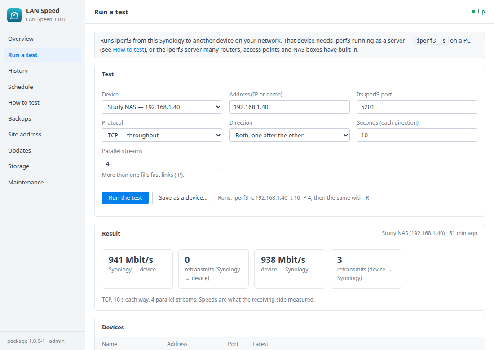
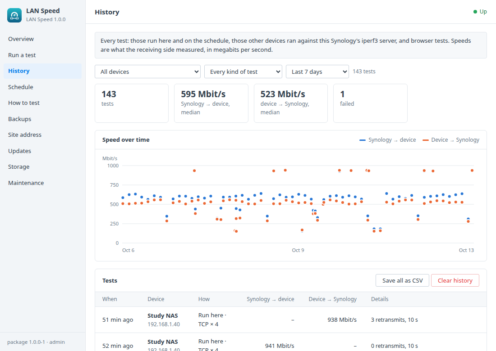
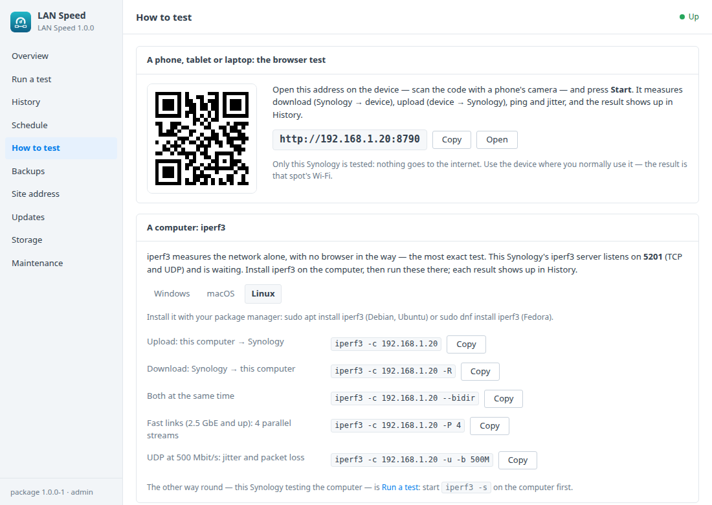
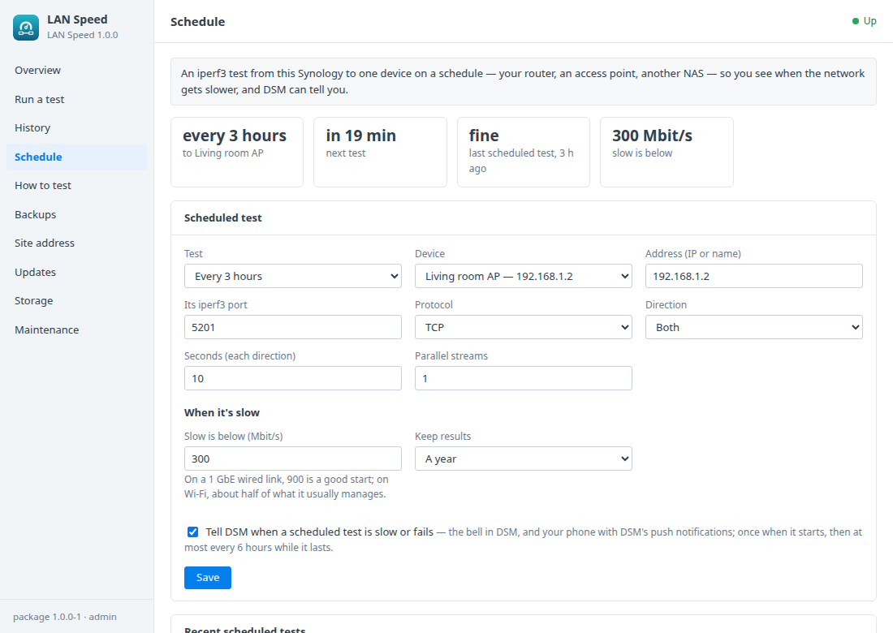

# LAN Speed for Synology DSM

A DSM 7 package that measures how fast your home network really is between
your Synology and your other devices — a web-based iperf. It runs in
Container Manager:
- an **iperf3 server** on the Synology, always on, for PCs and other devices
  that have iperf3;
- a **browser speed test** ([LibreSpeed](https://github.com/librespeed/speedtest))
  for phones, tablets and laptops that don't.

Both stay on your network: nothing is tested against the internet. A DSM
window looks after:
- iperf3 tests from the Synology to any device;
- every result, from every kind of test, with a chart per device;
- a test on a schedule, and a DSM notification when it's slow;
- the commands and the QR code to test from your devices;
- backups and updates.

Built on the [DSM app chassis](https://github.com/tombruton87/dsm-app-chassis).

## Download

### **[⬇ Download lanspeed.spk](https://github.com/tombruton87/lanspeed-dsm/releases/latest/download/lanspeed.spk)**

[](https://github.com/tombruton87/lanspeed-dsm/releases/latest)

That link always gives the newest version. Older ones are on the
[Releases](https://github.com/tombruton87/lanspeed-dsm/releases) page.

Install: Package Center → Manual Install → the `.spk` (DSM 7.2.1+; Container
Manager is installed first if missing). The wizard asks for the NAS's address,
the browser test's port (8790 by default), a time zone and the iperf3 port
(5201, iperf3's own). If a port is taken it suggests another (8791, 8792;
5202, 5203). Both ports appear in DSM's firewall list (Control Panel →
Security → Firewall → the LAN Speed entries), iperf3's for TCP and UDP.

## What the DSM window adds

- **Run a test**
  - iperf3 from the Synology to another device that runs `iperf3 -s`: a PC,
    a router or access point with an iperf3 server, another NAS.
  - TCP or UDP; upload (Synology → device), download (device → Synology,
    `-R`) or both; how long; parallel streams; for UDP, the rate to send at.
  - The result: Mbit/s each way, retransmits for TCP, jitter and packet loss
    for UDP — or a plain sentence when the device can't be reached.
  - Devices can be saved with a name; History and the schedule use it.
- **History**
  - Every test: those run here and on the schedule, those other devices run
    against the Synology's iperf3 server (logged from the server's side), and
    browser tests (device, download, upload, ping, jitter, when).
  - A chart over time, filters per device and kind of test, and every result
    as a CSV.
- **Schedule**
  - An iperf3 test to one device, every 15 minutes to once a day — the router,
    an access point, another NAS.
  - What counts as slow, and a DSM notification when a scheduled test is slow
    or fails: once when it starts, then at most every 6 hours while it lasts.
  - How long results are kept.
- **How to test**
  - The browser test's address, with a QR code for phones.
  - iperf3 commands to copy for Windows, macOS and Linux, with this NAS's
    address filled in.
  - What limits the result: Wi-Fi, 1 GbE ports, the browser — and that file
    copies (SMB, the disks) aren't involved.
- **Site address, backups, storage, maintenance** — the browser test's address
  and port, the iperf3 port, and HTTPS through DSM's reverse proxy. Backups hold
  checked copies of both databases; they're made nightly or on demand, with
  restore. You can also:
  - make a redacted support report;
  - read the logs;
  - remove LAN Speed and everything with it.

## Screenshots

| | |
|---|---|
|  |  |
|  |  |

## How it works

Two containers:
- `lanspeed-server` is iperf3's server. It runs on the Synology's own network
  (host networking), so tests see the real network card rather than Docker's
  bridge. Its image is built on the Synology from Alpine Linux's iperf3
  package (`setup/iperf3`). It takes one test at a time (`iperf3 -s -1 -J`)
  and leaves each test's JSON report for the package, which adds it to the
  history. Tests the window and the schedule run use `iperf3 -c` inside the
  same container, so they also go out through the Synology's own network card.
- `lanspeed-web` is LibreSpeed, pinned to a tested release
  (`ghcr.io/librespeed/speedtest`, the Alpine variant, chosen over the
  linuxserver.io image because it is LibreSpeed's own and smaller). It runs in
  standalone mode, so it only tests against itself. Its results are kept in
  its SQLite database (telemetry), and its own results page is locked with a
  random password. No IP lookup service is used, and nothing goes to the
  internet.

The history is a SQLite database in the `lanspeed_data` volume. LibreSpeed's
database is in `lanspeed_librespeed`. Every value that comes from another
device — an iperf3 report, a browser's user agent — is cut short, stripped
of control characters and quoted before it reaches the database.

A device's address and every test option are checked twice, by the window's
CGI and again by the setup container. An address is an IPv4 or IPv6 address
or a host name, nothing else. Every number has a range.

Updates: the chassis's own image check only reads Docker Hub, and its own
update would clear every unused image on the Synology. The package replaces
both. It looks for a newer LibreSpeed release on GitHub and ghcr.io, and for a
newer iperf3 in Alpine. When you press Update it makes a backup, moves to them,
and removes only the images it replaced.

## Layout

```
chassis/          the DSM app chassis (git submodule)
package.conf      name, title, services, volumes, images, ports, texts
app/compose.yaml  iperf3's server and LibreSpeed
setup/app.sh      the hooks: tests, the history, the schedule, alerts, updates, backups
setup/iperf3/     the iperf3 image, built on the Synology
setup/lanspeed.jq reading iperf3's and LibreSpeed's results
setup/take.sh     what's new for the history (run inside lanspeed-server)
ui/               Run a test, History, Schedule and How to test tabs; CGI validation
wizard/           the iperf3 page of the install wizard
tests/            steps for the chassis harness (real iperf3 and browser tests)
```

Test: `chassis/tests/e2e.sh . up && chassis/tests/e2e.sh . act` on any Linux
box with Docker. It runs real iperf3 tests to and from throwaway containers,
plus a browser test made with curl.

Release: bump `VERSION`, add the changes to `CHANGELOG.md`, build, then attach
the package twice, under its versioned name and as `lanspeed.spk`:

```bash
cp dist/lanspeed-X.Y.Z-1.spk /tmp/lanspeed.spk
gh release create vX.Y.Z dist/lanspeed-X.Y.Z-1.spk /tmp/lanspeed.spk
```

Build: `chassis/build.sh . N`.

## Credits

- [iperf3](https://github.com/esnet/iperf) is by ESnet (Energy Sciences
  Network) and Lawrence Berkeley National Laboratory, under a three-clause BSD
  licence. The package uses Alpine Linux's build of it.
- [LibreSpeed](https://github.com/librespeed/speedtest) is by Federico Dossena
  and contributors, under the GNU LGPL-3.0. The package runs its official
  Docker image unchanged.

The icon, a gauge over two linked devices, was drawn for this package. This
package is not affiliated with ESnet, LibreSpeed or Synology.
